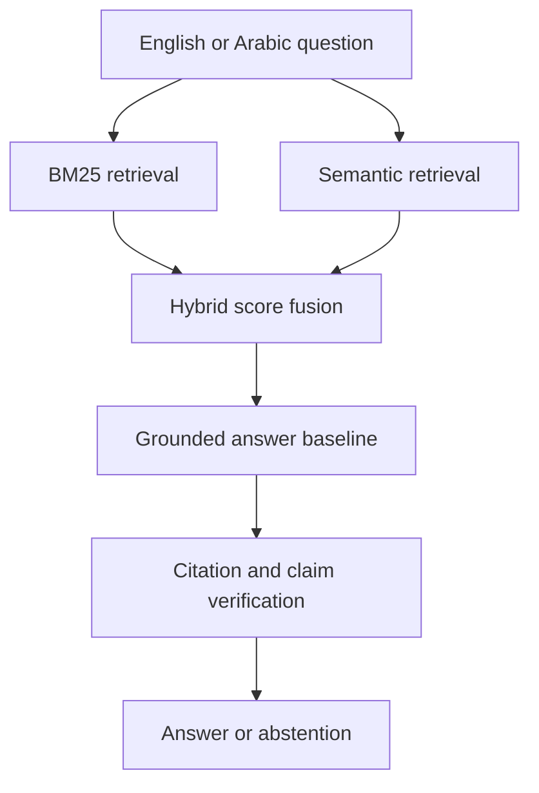

# EvidenceBench AI

**Evaluation-first retrieval, grounded answering, citation checking, and abstention**

EvidenceBench AI is an AI-engineering portfolio project for building and evaluating reliable retrieval-
augmented systems. The first release runs completely offline and exposes each stage of the pipeline: hybrid
retrieval, evidence-constrained answering, citation validation, claim-support scoring, abstention, ranking
metrics, a REST API, and an interactive dashboard.

## Why this project

Many RAG demos show only a chatbot interface. EvidenceBench treats evaluation as part of the product. It
records retrieval scores, verifies citation identifiers, measures whether answer claims are supported by the
retrieved text, and abstains when retrieval evidence is weak.

## Current capabilities

- BM25 lexical retrieval implemented from first principles
- TF-IDF semantic-search baseline with an embedding-compatible interface
- Configurable hybrid score fusion
- English and Arabic tokenization
- Deterministic evidence-constrained answer baseline
- Inline citations and citation validation
- Claim-support scoring
- Explicit low-confidence abstention
- MRR, recall at k, and nDCG at k evaluation
- FastAPI service and interactive Streamlit dashboard
- Automated tests, Docker, Docker Compose, and GitHub Actions

## Architecture



## Quick start

```bash
python -m venv .venv
source .venv/bin/activate
pip install -r requirements.txt
PYTHONPATH=src python scripts/run_evaluation.py
PYTHONPATH=src streamlit run app.py
```

Windows PowerShell activation:

```powershell
.venv\Scripts\Activate.ps1
```

Run the API:

```bash
PYTHONPATH=src uvicorn api:app --reload
```

Open `http://127.0.0.1:8000/docs` for the interactive API documentation.

Run with Docker:

```bash
docker compose up --build
```

## Evaluation

```bash
PYTHONPATH=src python scripts/run_evaluation.py
PYTHONPATH=src pytest
ruff check .
ruff format --check .
```

The included five-document bilingual collection is a deterministic smoke-test fixture, not a research
benchmark. A reproducible SciFact integration is included for meaningful retrieval evaluation on 5,183 scientific
abstracts and the labeled development claims. Dataset files are downloaded from the official release, checksum
verified, locally prepared, and excluded from Git.

```bash
PYTHONPATH=src python scripts/download_scifact.py
PYTHONPATH=src python scripts/run_scifact_benchmark.py
```

Do not present the smoke-test metrics as model performance. Use the generated
`outputs/scifact_retrieval_metrics.json` for portfolio reporting after running the public benchmark. See
[`DATA_LICENSES.md`](DATA_LICENSES.md) for attribution and license details.

### SciFact development results

| Retriever | MRR | nDCG@10 | Recall@10 |
| --- | ---: | ---: | ---: |
| BM25 | **0.794** | **0.822** | **0.924** |
| Hybrid BM25 + TF-IDF | 0.776 | 0.803 | 0.912 |
| TF-IDF | 0.724 | 0.757 | 0.887 |

These values were produced from 188 labeled development claims. They demonstrate that BM25 is the strongest
implemented baseline on this dataset; they do not imply state-of-the-art performance. The committed machine-
readable result is in `outputs/scifact_retrieval_metrics.json`.

## Engineering decisions

- **Evaluation before generation:** bad retrieval cannot be repaired reliably by fluent text generation.
- **Deterministic offline baseline:** reviewers can reproduce core behavior without API keys or paid services.
- **Abstention:** the system returns insufficient-evidence status below a configurable confidence threshold.
- **Visible component scores:** lexical, semantic, and fused scores can be inspected instead of hidden.
- **Typed boundaries:** dataclasses and FastAPI schemas make component behavior explicit and testable.

## Known limitations

- TF-IDF is a lexical vector-space baseline, not a transformer embedding model.
- Score fusion uses a fixed weight and is not yet tuned on a held-out split.
- Claim support uses token overlap and should not be interpreted as entailment.
- English/Arabic tokenization is supported, but the public benchmark result is English-only.
- The extractive generator is intentionally deterministic and is not a substitute for an evaluated LLM.

## Planned next release

- Sentence-transformer embeddings and vector indexing
- Cross-encoder reranking
- Pluggable open-source and hosted LLM providers
- Ground-truth answer and citation evaluation beyond retrieval
- Calibration curves and risk-coverage analysis
- Retrieval-noise and evidence-conflict tests
- Experiment tracking and model/data cards
- Public deployment and demonstration video

## Author

**Mahmoud Faraj**  
PhD in Electrical and Computer Engineering, University of Waterloo  
Applied AI, machine learning, data science, and AI engineering

## License

This project is released under the [MIT License](LICENSE).
